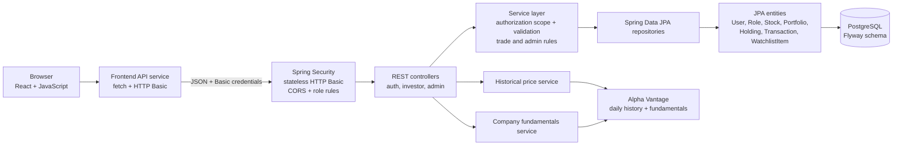

# SmartStock architecture

## System context

The browser runs a React/Vite single-page application. Its API module sends JSON requests to the Spring Boot REST API. The backend performs authentication and authorization, applies investor/admin business rules in services, and persists application data through Spring Data JPA/Hibernate into PostgreSQL. Flyway owns schema creation and versioned migration.



The H2 profile substitutes an in-memory database for PostgreSQL during local development/testing. It is not the persistence target for durable data.

## Backend layers

- **Controllers** map REST paths and HTTP methods, receive validated request DTOs, obtain the authenticated principal where needed, and delegate to services. Examples include `PortfolioController`, `WatchlistController`, and the admin dashboard/user/stock controllers.
- **Services** own application rules and transaction boundaries. `PortfolioService` checks ownership, quantities, execution-price availability, cash/holdings, and calculation rules. `WatchlistService` scopes entries to the principal. Admin services implement user role changes, stock metadata/deletion rules, and aggregate counts.
- **Repositories** provide Spring Data persistence and targeted queries, including counts used for the admin dashboard.
- **Entities** model persisted state. A `User` has `Role` values as an eager JPA element collection stored in `user_roles`; portfolios, holdings, transactions, and watchlist entries have relational associations to their owners/stocks.
- **DTOs** define request/response boundaries so entity internals—especially password hashes—are not serialized as API responses.
- **Security** is configured in `SecurityConfig`. HTTP Basic is stateless; `DatabaseUserDetailsService` loads the account and maps persisted roles to `ROLE_USER`/`ROLE_ADMIN`. All API routes except authentication and health require authentication. `/api/v1/admin/**` requires `ROLE_ADMIN`. CORS permits configured origins.
- **Market data** is accessed by `HistoricalStockPriceService` and `CompanyFundamentalsService` through the configured Alpha Vantage `RestClient`. Provider responses are cached in memory. Seeded price quotes are labeled `demo`; provider history is daily and unadjusted. Provider plan and quota restrictions can leave metrics unavailable or produce partial fundamentals.

## Authentication and authorization flow

```mermaid
sequenceDiagram
    actor Investor
    participant UI as React UI / API service
    participant Auth as AuthController / AuthService
    participant Users as UserRepository
    participant DB as PostgreSQL
    participant Sec as Spring Security
    participant Details as DatabaseUserDetailsService
    participant Route as Protected controller

    Investor->>UI: Submit username and password
    UI->>Auth: POST /api/v1/auth/login
    Auth->>Users: Find user by username
    Users->>DB: Load user and eager roles
    DB-->>Users: User, password hash, roles
    Users-->>Auth: User
    Auth->>Auth: Verify password with BCrypt
    Auth-->>UI: Account metadata and persisted role names only
    UI->>UI: Keep entered credentials in memory
    UI->>Sec: Request with HTTP Basic credentials
    Sec->>Details: Load user and role authorities
    Details->>Users: Load account by username
    Users-->>Details: Account with persisted roles
    Sec->>Sec: Require authentication; admin routes also require ROLE_ADMIN
    Sec->>Route: Invoke authorized route
```

Public registration constructs a user with `Role.USER`; request fields cannot select roles. Admin links in the UI are a convenience only. The backend security filter remains the authorization boundary.

## Investor request flows

### Portfolio and virtual trades

```mermaid
sequenceDiagram
    actor Investor
    participant UI as React UI
    participant Security as Spring Security
    participant Controller as PortfolioController
    participant Service as PortfolioService
    participant Repositories as JPA repositories
    participant DB as PostgreSQL

    Investor->>UI: Choose portfolio, stock, side, quantity
    UI->>Security: POST /api/v1/portfolios/{id}/buy or /sell
    Security->>Controller: Authenticated principal
    Controller->>Service: Principal name, portfolio ID, trade request
    Service->>Repositories: Lock and load portfolio; resolve user and stock
    Repositories->>DB: Read/write transaction
    Service->>Service: Verify owner, quantity, stored server-side price,<br/>virtual cash or shares; calculate cost/proceeds and P&L
    Service->>Repositories: Update cash/holding and record transaction
    Repositories->>DB: Commit all changes transactionally
    Service-->>UI: Portfolio DTO with holdings and history
```

The trade price is resolved from the backend's stored stock record, not trusted from a client-supplied value. An invalid/unavailable source or price rejects the trade. Monetary arithmetic uses `BigDecimal`; the service transaction keeps cash, holdings, and history updates together. Portfolio lookups for changes are locked and filtered to the authenticated owner.

Portfolio responses include current cash, total value, holdings with average cost and unrealized P/L, transaction history, realized P/L, and total P/L. Values are derived by backend services rather than accepted from the frontend.
The owner can rename a portfolio with `PUT /api/v1/portfolios/{portfolioId}`. The controller takes the authenticated principal and a validated name DTO; the service locks the portfolio, verifies ownership, changes only its name, and returns the existing portfolio summary.

### Watchlist

The watchlist controller passes the authenticated username to `WatchlistService`. The service loads the user and adds, lists, or deletes only entries belonging to that user. The client submits stock symbols but never supplies a user ID for ownership.

### Investment journal

`InvestmentJournalController` passes the authenticated username to `InvestmentJournalService`. The service queries and mutates entries only when their owner matches that username. Journal text and tags use dedicated `investment_journal_entries` and `investment_journal_tags` tables. An optional linked trade is accepted only when it is a completed transaction belonging to the same user; the journal reads its symbol/type/date but never modifies trade, holding, or cash records.

### Stock discovery and intelligence

`GET /api/v1/stocks` returns the supported-stock DTOs and their configured price source. Historical daily prices and fundamentals are separate backend provider services. Provider API credentials remain backend-only; the React environment variable is only the API base URL. Historical data is not a real-time quote feed, and fundamentals can be incomplete under provider plan restrictions.

## Admin request flow

All `/api/v1/admin/**` requests first pass through the same HTTP Basic filter and require the persisted `ROLE_ADMIN` authority. Controllers delegate to admin services:

- **Dashboard:** `AdminDashboardService` calls repository count methods and returns aggregate numbers; it does not load or return private portfolio/transaction records.
- **User management:** `AdminUserService` returns a sanitized `AdminUserResponse`, permits `USER`/`ADMIN` role changes for another account, and rejects self-role changes. Registration remains `USER`-only.
- **Stock management:** `AdminStockService` validates/normalizes symbols, sets a newly created stock's price source to unavailable, and only updates company/sector metadata. Deletion is refused while a holding, transaction, or watchlist references the stock.

The database schema is versioned under `backend/src/main/resources/db/migration`. The initial migration creates `users`, `user_roles`, `stocks`, `portfolios`, `holdings`, `transactions`, and `watchlist_items`, including ownership and reference constraints.
